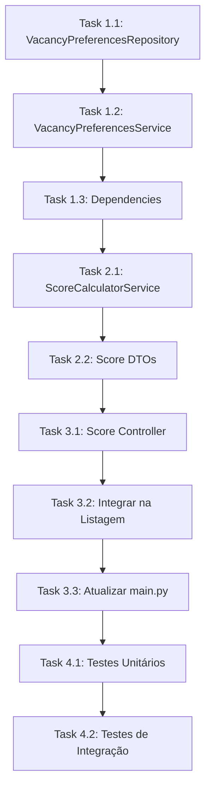

# Refinamento: Sistema de Cálculo de Score de Compatibilidade

## 📋 Resumo Executivo

Implementar um sistema de cálculo de score que determine a porcentagem de compatibilidade entre:
- **Usuário ↔ Vaga (Vacancy)**: Quanto um usuário é compatível com os requisitos de uma vaga
- **Vaga ↔ Usuário**: Quanto uma vaga atende às preferências de um usuário

O score será uma porcentagem (0-100%) baseada nas preferências cadastradas.

---

## 📊 Análise do Estado Atual

### Estrutura de Dados Existente

#### Tabela `preferences`
| Coluna | Tipo | Descrição |
|--------|------|-----------|
| id | Integer | PK |
| title | String | Nome da preferência (ex: "Fumante", "Aceita pets") |
| preference_type | Enum | `USER` ou `VACANCY` |

#### Tabela `user_preferences`
| Coluna | Tipo | Descrição |
|--------|------|-----------|
| id | Integer | PK |
| user_id | Integer | FK → users.id |
| preference_id | Integer | FK → preferences.id |
| rate | Enum | `YES`, `NO`, `INDIFFERENT` |

#### Tabela `vacancy_preferences`
| Coluna | Tipo | Descrição |
|--------|------|-----------|
| id | Integer | PK |
| vacancy_id | Integer | FK → vacancies.id |
| preference_id | Integer | FK → preferences.id |
| rate | Enum | `YES`, `NO`, `INDIFFERENT` |

### Enum `PreferenceResponse`
```python
class PreferenceResponse(Enum):
    NO = "NO"
    INDIFFERENT = "INDIFFERENT"  
    YES = "YES"
```

### Serviço Existente (Vazio)
```python
# backend/app/services/score_calculator_service.py
class ScoreCalculatorService:
    def __init__(self):
        pass
```

### Frontend - Expectativa de Dados
O frontend já espera o score no formato:
```typescript
interface MatchScore {
  percentage: number;      // 0-100
  level: "high" | "medium" | "low";
  icon: string;           // classe CSS do ícone
}
```

---

## 🎯 Regras de Negócio do Score

### Matriz de Compatibilidade

Para cada preferência comparada entre Usuário e Vaga:

| Usuário | Vaga | Pontuação | Descrição |
|---------|------|-----------|-----------|
| YES | YES | 100% | Compatibilidade total |
| NO | NO | 100% | Compatibilidade total |
| YES | NO | 0% | Incompatível |
| NO | YES | 0% | Incompatível |
| YES | INDIFFERENT | 75% | Vaga aceita, porém sem preferência |
| NO | INDIFFERENT | 75% | Vaga aceita, porém sem preferência |
| INDIFFERENT | YES | 75% | Usuário aceita, sem preferência |
| INDIFFERENT | NO | 75% | Usuário aceita, sem preferência |
| INDIFFERENT | INDIFFERENT | 50% | Ambos indiferentes |

### Cálculo do Score Final

```
Score = (Σ pontuação_de_cada_preferência) / (total_de_preferências_comparáveis) * 100
```

### Classificação do Nível

| Score | Level |
|-------|-------|
| 70-100% | high |
| 40-69% | medium |
| 0-39% | low |

> **Nota**: Os ícones associados a cada nível são definidos pelo frontend, não pelo backend.

### Casos Especiais

1. **Sem preferências cadastradas**: Score = 50% (neutro)
2. **Preferências parciais**: Calcular apenas com preferências em comum
3. **Vaga sem preferências**: Usar apenas preferências do usuário que são do tipo `VACANCY`

---

## 📁 Arquivos a Serem Criados/Modificados

### Backend

#### 1. Novo Repositório: `vacancy_preferences_repository.py`
**Caminho**: `backend/app/repositories/vacancy_preferences_repository.py`
**Motivo**: Não existe repositório para acessar preferences de vagas

```python
# Métodos necessários:
- get_vacancy_preferences(vacancy_id) -> List[Dict]
- get_vacancy_preferences_with_details(vacancy_id) -> List[Dict]
- create_vacancy_preference(vacancy_id, preference_id, rate)
- update_vacancy_preference(vacancy_id, preference_id, rate)
- upsert_vacancy_preference(vacancy_id, preference_id, rate)
- delete_vacancy_preference(vacancy_id, preference_id)
```

#### 2. Implementar: `score_calculator_service.py`
**Caminho**: `backend/app/services/score_calculator_service.py`

```python
# Métodos necessários:
- calculate_user_vacancy_score(user_id, vacancy_id) -> ScoreResult
- calculate_vacancy_user_score(vacancy_id, user_id) -> ScoreResult  
- calculate_score_batch(user_id, vacancy_ids) -> List[ScoreResult]
- _compare_preferences(user_prefs, vacancy_prefs) -> float
- _get_compatibility_score(user_rate, vacancy_rate) -> float
- _classify_score_level(percentage) -> str
```

#### 3. Novo DTO: `score_dto.py`
**Caminho**: `backend/interface/dto/score_dto.py`

```python
class ScoreResultDTO(BaseModel):
    percentage: int        # 0-100
    level: str            # "high", "medium", "low" (semântico, não visual)
    details: Optional[Dict]  # breakdown do score

class ScoreBatchRequestDTO(BaseModel):
    user_id: int
    vacancy_ids: List[int]

class ScoreBatchResponseDTO(BaseModel):
    scores: List[Dict[int, ScoreResultDTO]]
```

> **Nota**: O ícone não é enviado pelo backend. A escolha do ícone é responsabilidade do frontend, que mapeia o `level` para o elemento visual apropriado. Isso respeita a separação de responsabilidades (backend = dados, frontend = apresentação).

#### 4. Novo Controller: `score_controller.py`
**Caminho**: `backend/interface/controllers/score_controller.py`

##### Status Codes Comuns:

| Código | Significado | Quando Ocorre |
|--------|-------------|---------------|
| 200 | OK | Requisição processada com sucesso |
| 400 | Bad Request | Parâmetros inválidos (ex: IDs negativos) |
| 404 | Not Found | Usuário ou vaga não encontrados |
| 500 | Internal Server Error | Erro inesperado no servidor |

##### Endpoints:

| Método | Rota | Descrição |
|--------|------|----------|
| GET | `/score/user/{user_id}/vacancy/{vacancy_id}` | Calcula score de compatibilidade entre um usuário e uma vaga |
| POST | `/score/batch` | Calcula scores em lote para múltiplas vagas |
| GET | `/vacancies/for-user/{user_id}/with-scores` | Lista vagas ordenadas por score de compatibilidade |
| GET | `/users/for-vacancy/{vacancy_id}/with-scores` | Lista usuários ordenados por score de compatibilidade |

#### 5. Atualizar: `dependencies.py`
**Adicionar**:
- `get_vacancy_preferences_repository()`
- `get_score_calculator_service()`

#### 6. Atualizar: `vacancy_controller.py`
**Modificar** endpoint de listagem para incluir score quando user_id for informado

#### 7. Novo Service: `vacancy_preferences_service.py`
**Caminho**: `backend/app/services/vacancy_preferences_service.py`
**Motivo**: Gerenciar preferências de vagas (similar ao UserPreferencesService)

---

## 📋 Plano de Implementação (Tasks)

### Sprint 1: Infraestrutura Base

#### Task 1.1: Criar VacancyPreferencesRepository
**Arquivos**:
- `backend/app/repositories/vacancy_preferences_repository.py`

**Critérios de Aceite**:
- [ ] Implementar todos os métodos CRUD
- [ ] Implementar `get_vacancy_preferences_with_details()` com JOIN
- [ ] Seguir padrão do `UserPreferencesRepository`

#### Task 1.2: Criar VacancyPreferencesService
**Arquivos**:
- `backend/app/services/vacancy_preferences_service.py`

**Critérios de Aceite**:
- [ ] Implementar métodos de negócio
- [ ] Validar existência de preferência antes de criar
- [ ] Seguir padrão do `UserPreferencesService`

#### Task 1.3: Atualizar Dependencies
**Arquivos**:
- `backend/app/dependencies.py`

**Critérios de Aceite**:
- [ ] Adicionar factory para VacancyPreferencesRepository
- [ ] Adicionar factory para VacancyPreferencesService

---

### Sprint 2: Score Calculator Core

#### Task 2.1: Implementar ScoreCalculatorService
**Arquivos**:
- `backend/app/services/score_calculator_service.py`

**Critérios de Aceite**:
- [ ] Implementar matriz de compatibilidade
- [ ] Calcular score entre user e vacancy
- [ ] Calcular score em batch (múltiplas vagas)
- [ ] Classificar nível (high/medium/low) - semântico, não visual
- [ ] Retornar breakdown do score (opcional)
- [ ] Tratar casos sem preferências
- [ ] NÃO incluir ícones (responsabilidade do frontend)

**Pseudo-código**:
```python
def calculate_user_vacancy_score(self, user_id: int, vacancy_id: int) -> ScoreResult:
    user_prefs = self.user_prefs_repo.get_user_preferences_with_details(user_id)
    vacancy_prefs = self.vacancy_prefs_repo.get_vacancy_preferences_with_details(vacancy_id)
    
    if not user_prefs or not vacancy_prefs:
        return ScoreResult(percentage=50, level="medium")
    
    total_score = 0
    comparisons = 0
    
    # Criar mapa de preferências da vaga
    vacancy_map = {p["preference_id"]: p["rate"] for p in vacancy_prefs}
    
    for user_pref in user_prefs:
        pref_id = user_pref["preference_id"]
        if pref_id in vacancy_map:
            score = self._get_compatibility_score(
                user_pref["rate"], 
                vacancy_map[pref_id]
            )
            total_score += score
            comparisons += 1
    
    if comparisons == 0:
        return ScoreResult(percentage=50, level="medium")
    
    percentage = int((total_score / comparisons) * 100)
    level = self._classify_score_level(percentage)
    
    return ScoreResult(percentage=percentage, level=level)
```

#### Task 2.2: Criar Score DTOs
**Arquivos**:
- `backend/interface/dto/score_dto.py`

**Critérios de Aceite**:
- [ ] DTO de resposta individual
- [ ] DTO de resposta em batch
- [ ] Compatível com frontend existente

---

### Sprint 3: API Endpoints

#### Task 3.1: Criar Score Controller
**Arquivos**:
- `backend/interface/controllers/score_controller.py`

---

##### `GET /api/score/user/{user_id}/vacancy/{vacancy_id}`

**Descrição**: Calcula a porcentagem de compatibilidade entre um usuário específico e uma vaga específica, comparando suas preferências cadastradas.

**Parâmetros de Rota**:
| Parâmetro | Tipo | Obrigatório | Descrição |
|-----------|------|-------------|----------|
| `user_id` | int | Sim | ID do usuário que busca vaga |
| `vacancy_id` | int | Sim | ID da vaga a ser comparada |

**Response 200 OK**:
```json
{
  "percentage": 85,
  "level": "high",
  "details": {
    "total_preferences_compared": 8,
    "matches": 7,
    "partial_matches": 1,
    "incompatibilities": 0
  }
}
```

**Response 404 Not Found**:
```json
{
  "detail": "Usuário ou vaga não encontrado"
}
```

---

##### `POST /api/score/batch`

**Descrição**: Calcula scores de compatibilidade para múltiplas vagas de uma só vez. Útil para popular listagens com scores sem fazer múltiplas requisições.

**Request Body**:
```json
{
  "user_id": 1,
  "vacancy_ids": [1, 2, 3, 4, 5]
}
```

**Response 200 OK**:
```json
{
  "user_id": 1,
  "scores": [
    { "vacancy_id": 1, "percentage": 92, "level": "high" },
    { "vacancy_id": 2, "percentage": 58, "level": "medium" },
    { "vacancy_id": 3, "percentage": 25, "level": "low" },
    { "vacancy_id": 4, "percentage": 75, "level": "high" },
    { "vacancy_id": 5, "percentage": 50, "level": "medium" }
  ],
  "calculated_at": "2026-03-02T14:30:00Z"
}
```

---

##### `GET /api/vacancies/for-user/{user_id}/with-scores`

**Descrição**: Retorna lista de vagas disponíveis com score de compatibilidade calculado para o usuário. Ordenado por score decrescente (melhores matches primeiro).

**Parâmetros de Rota**:
| Parâmetro | Tipo | Obrigatório | Descrição |
|-----------|------|-------------|----------|
| `user_id` | int | Sim | ID do usuário para calcular compatibilidade |

**Query Parameters**:
| Parâmetro | Tipo | Default | Descrição |
|-----------|------|---------|----------|
| `skip` | int | 0 | Offset para paginação |
| `limit` | int | 20 | Quantidade máxima de resultados |
| `min_score` | int | 0 | Filtrar apenas vagas com score >= valor |

**Response 200 OK**:
```json
{
  "user_id": 1,
  "vacancies": [
    {
      "id": 5,
      "title": "Quarto em apartamento no Centro",
      "rent": "1200.00",
      "address_neighborhood": "Centro",
      "match_score": {
        "percentage": 92,
        "level": "high"
      }
    },
    {
      "id": 3,
      "title": "Suite em casa compartilhada",
      "rent": "800.00",
      "address_neighborhood": "Jardins",
      "match_score": {
        "percentage": 78,
        "level": "high"
      }
    }
  ],
  "total": 15,
  "skip": 0,
  "limit": 20
}
```

---

##### `GET /api/users/for-vacancy/{vacancy_id}/with-scores`

**Descrição**: Retorna lista de usuários com score de compatibilidade calculado para a vaga. Usado pelo dono da vaga para ver candidatos mais compatíveis.

**Parâmetros de Rota**:
| Parâmetro | Tipo | Obrigatório | Descrição |
|-----------|------|-------------|----------|
| `vacancy_id` | int | Sim | ID da vaga para calcular compatibilidade |

**Query Parameters**:
| Parâmetro | Tipo | Default | Descrição |
|-----------|------|---------|----------|
| `skip` | int | 0 | Offset para paginação |
| `limit` | int | 20 | Quantidade máxima de resultados |
| `min_score` | int | 0 | Filtrar apenas usuários com score >= valor |

**Response 200 OK**:
```json
{
  "vacancy_id": 1,
  "users": [
    {
      "id": 12,
      "name": "Maria Silva",
      "profile_picture_path": "/uploads/maria.jpg",
      "match_score": {
        "percentage": 88,
        "level": "high"
      }
    },
    {
      "id": 7,
      "name": "João Santos",
      "profile_picture_path": "/uploads/joao.jpg",
      "match_score": {
        "percentage": 65,
        "level": "medium"
      }
    }
  ],
  "total": 8,
  "skip": 0,
  "limit": 20
}
```

---

#### Task 3.2: Integrar Score na Listagem de Vagas Existente
**Arquivos**:
- `backend/interface/controllers/vacancy_controller.py`
- `backend/interface/dto/vacancy_dto.py`

**Descrição**: Modificar o endpoint existente de listagem de vagas para opcionalmente calcular e incluir scores de compatibilidade.

##### `GET /api/vacancies` (modificado)

**Novo Query Parameter**:
| Parâmetro | Tipo | Default | Descrição |
|-----------|------|---------|----------|
| `for_user_id` | int | null | Quando informado, calcula e inclui o score de compatibilidade para este usuário |

**Response com `for_user_id`**:
```json
{
  "vacancies": [
    {
      "id": 1,
      "title": "Quarto em apartamento",
      "rent": "1200.00",
      "match_score": {
        "percentage": 85,
        "level": "high"
      }
    }
  ],
  "total": 10
}
```

**Response sem `for_user_id`** (comportamento atual mantido):
```json
{
  "vacancies": [
    {
      "id": 1,
      "title": "Quarto em apartamento",
      "rent": "1200.00"
    }
  ],
  "total": 10
}
```

#### Task 3.3: Atualizar main.py
**Arquivos**:
- `backend/main.py`

**Modificações**:
- Registrar novo router de score

---

### Sprint 4: Testes e Refinamentos

#### Task 4.1: Testes Unitários
**Arquivos**:
- `backend/tests/test_score_calculator_service.py` (criar)

**Cenários de Teste**:
- [ ] Score 100% (todas preferências YES-YES ou NO-NO)
- [ ] Score 0% (todas incompatíveis)
- [ ] Score misto
- [ ] Usuário sem preferências
- [ ] Vaga sem preferências
- [ ] Preferências parcialmente preenchidas
- [ ] INDIFFERENT em diferentes combinações

#### Task 4.2: Testes de Integração
**Arquivos**:
- `backend/tests/test_score_endpoints.py` (criar)

---

## 🔌 Integração com Frontend

### Modificações Necessárias (Frontend)

O frontend já possui a estrutura pronta para receber scores. Será necessário:

1. **Atualizar `vacancyService.ts`**:
   - Consumir endpoint de vagas com score
   - Mapear response para o formato esperado

2. **Atualizar hook/service que lista vagas**:
   - Passar `user_id` para obter scores personalizados

### Exemplo de Integração
```typescript
// frontend/src/api/vacancyService.ts
const getScoreIcon = (level: string): string => {
  const icons: Record<string, string> = {
    high: "fa-solid fa-heart",
    medium: "fa-solid fa-thumbs-up",
    low: "fa-solid fa-circle-xmark"
  };
  return icons[level] || "fa-solid fa-question";
};

export const getVacanciesWithScore = async (userId: number) => {
  const response = await api.get(`/vacancies?for_user_id=${userId}`);
  return response.data.map(v => ({
    ...v,
    matchScore: {
      percentage: v.score.percentage,
      level: v.score.level,
      icon: getScoreIcon(v.score.level)  // Frontend mapeia level → ícone
    }
  }));
};
```

---

## 📈 Métricas de Sucesso

1. **Performance**: Cálculo de score para 100 vagas < 500ms
2. **Cobertura**: 100% das preferências consideradas no cálculo
3. **Precisão**: Scores refletem corretamente a matriz de compatibilidade

---

## ⚠️ Riscos e Mitigações

| Risco | Impacto | Probabilidade | Mitigação |
|-------|---------|---------------|-----------|
| Performance com muitas preferências | Alto | Médio | Implementar cache de preferências |
| Usuários sem preferências cadastradas | Médio | Alto | Definir score neutro (50%) |
| Inconsistência de dados | Alto | Baixo | Validar integridade no service |

---

##  Dependências



---

## 📝 Notas Adicionais

### Preferências de Exemplo (Seeds)

| ID | Título | Tipo |
|----|--------|------|
| 1 | Fumante | USER |
| 2 | Tem pets | USER |
| 3 | Trabalha em casa | USER |
| 4 | Aceita fumante | VACANCY |
| 5 | Aceita pets | VACANCY |
| 6 | Ambiente silencioso | VACANCY |

### Possível Evolução Futura

1. **Pesos por preferência**: Algumas preferências podem ter mais importância
2. **Score bidirecional**: Média entre score user→vacancy e vacancy→user
3. **Machine Learning**: Usar histórico de matches para refinar scores
4. **Preferências de localização**: Incluir proximidade no cálculo
